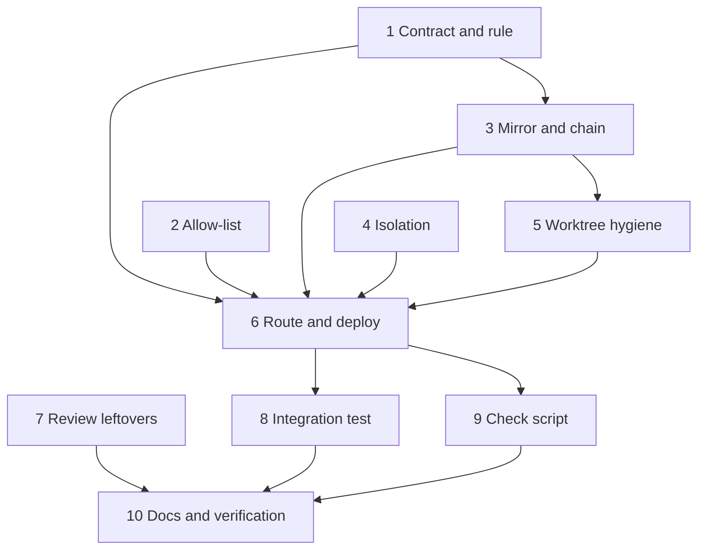

# Implementation Plan: fix-deploy

## Overview

Add `POST /chaos/deploy-fix` with exactly the Haunted Ops Contract, a bare mirror `data/repo.git` that fetches only `incident/*`, the new allow-list (`named`, `fix`, `denied`), isolation of fix children (whitelist env, `node --permission`, optional `FIX_RUN_AS_USER`), worktree hygiene, the two open review leftovers (G1 real-branch mode, bounded deploy log open), tests against a local origin fixture, and `scripts/fix-deploy-check.mjs` for the Haunted Ops G-MVP gate. Ten top-level tasks. Property tests are their own sub-tasks (marked `*`) and carry `// Feature: fix-deploy, Property N`. No new dependency. No push, ever: tests push only to a temp bare repo.

## Tasks

- [ ] 1. Contract types, body validator and the deploy rule
  - [ ] 1.1 Add `supervisor/src/fix-contract.ts`: `DeployFixRequest`, `DeployFixResponse`, `FileChange`, `ChainCommit`, `FixRefusal`, and `validateDeployFixBody` (exactly three keys, the service list, `^incident/c[a-z0-9]{24}$`, `^[0-9a-f]{40}$`)
    - _Requirements: 1.3, 1.4_
  - [ ]* 1.2 Property test: body validation is total and exact (Property 2)
    - _Requirements: 1.3, 1.4_
  - [ ] 1.3 Implement the pure `deployFixAllowed` with the fixed rule order (`not_head`, `empty_fix`, `chain_too_long`, `no_allowed_base`, then per commit `binary_or_special_change`, `manifest_change`, `outside_service`, then `diff_too_large`), statuses 409 and 422
    - _Requirements: 3.1, 3.2, 3.3, 3.4, 3.6, 4.1, 4.2, 4.3, 4.4, 4.5_
  - [ ]* 1.4 Property test: the deploy rule accepts exactly a clean chain from the head to an allowed head (Property 1)
    - _Requirements: 3.1, 3.2, 3.3, 3.4, 3.6, 4.1, 4.2, 4.3, 4.4, 4.5_
- [ ] 2. Allow-list
  - [ ] 2.1 Change `classifyRef` to `named` / `fix` / `denied`, remove the `reserved` class and 403 `ref_reserved`, and make `Lab.#deploy` refuse a `fix` ref unless called from `deployFix`; update the existing refs and chaos tests
    - _Requirements: 7.1, 7.2, 7.3, 7.4_
  - [ ]* 2.2 Property test: refs are classified into named, fix and denied (Property 3)
    - _Requirements: 7.1, 7.2, 7.3, 7.4_
- [ ] 3. Mirror, origin and chain reading
  - [ ] 3.1 Add `parseOriginUrl` and the config names `LAB_ORIGIN_URL` (default the public GitHub URL) and `LAB_ALLOW_FILE_ORIGIN`; errors name the variable only
    - _Requirements: 2.4, 2.5_
  - [ ]* 3.2 Property test: the origin URL validator accepts only plain public https (Property 4)
    - _Requirements: 2.4, 2.5_
  - [ ] 3.3 Add `supervisor/src/mirror.ts`: create `data/repo.git` as a bare clone of the source checkout, create `data/` with mode `0700`, set `origin` and the `incident/*`-only fetch refspec, seed `main` and `scenario/*` from the source at every start, delete other local refs; switch deploys and diffs to the mirror
    - _Requirements: 6.1, 6.2, 6.3, 6.7, 10.2_
  - [ ] 3.4 Implement the one-ref fetch: `ls-remote --exit-code` then `fetch --no-tags --no-recurse-submodules origin --end-of-options +refs/heads/<ref>:refs/heads/<ref>`, isolated git env with `GIT_ALLOW_PROTOCOL` (`https`, `https:file` only with the test flag), 30 s timeout, one fetch at a time; map to 404 `unknown_ref` and 503 `origin_unreachable`
    - _Requirements: 2.1, 2.2, 2.3, 2.6_
  - [ ] 3.5 Keep at most 50 local incident refs (`data/incident-refs.json`), delete older ones locally only
    - _Requirements: 6.6_
  - [ ]* 3.6 Property test: the incident ref limit keeps the newest 50 (Property 9)
    - _Requirements: 6.6_
  - [ ] 3.7 Compute the allowed heads: with `scripts/scenario-shas.json`, `verifyPlantRecord` on the mirror must pass (else 503 `lab_not_pinned`); without it, the four branch heads, logged once as not pinned
    - _Requirements: 3.5_
  - [ ] 3.8 Add `supervisor/src/fix-chain.ts`: first-parent walk (`rev-list --first-parent --max-count=21`), per-commit `diff-tree -r -M --raw -z` and `--numstat -z` against the first parent, total `diff --numstat` from the reached head, 1 MiB output caps; unit tests on the fixture (merge against its first parent, rename both paths, binary, symlink, mode change)
    - _Requirements: 3.2, 4.1, 4.2, 4.4_
- [ ] 4. Isolation of fix children
  - [ ] 4.1 Risk check on Node 26.7: a service started with `--permission`, the three `--allow-fs-read` paths and `--allow-net` runs from a mirror worktree with symlinked `node_modules`, serves `/healthz` and `/metrics`, and cannot read a file outside the paths or spawn a process; record the outcome in Notes
    - _Requirements: 9.2, 9.3_
  - [ ] 4.2 Add `supervisor/src/isolation.ts` with `fixChildEnv` and `fixChildArgs`; the runner uses them for `fix` deployments only and keeps `main` / `scenario/*` children as they are
    - _Requirements: 9.1, 9.2, 9.3, 9.7_
  - [ ]* 4.3 Property test: a fix child gets exactly the whitelist env (Property 5)
    - _Requirements: 9.1_
  - [ ]* 4.4 Property test: a fix child's permission flags are exactly the allowed set (Property 6)
    - _Requirements: 9.2, 9.3_
  - [ ] 4.5 Add `FIX_RUN_AS_USER`: name pattern, uid and gid via `execFile('id', ...)`, refuse uid 0 and the own uid, spawn fix children with `{ uid, gid }`, startup probe (exit 1 naming the variable), and the one-time "development only" log line when unset; unit tests for validation and the log line
    - _Requirements: 9.4, 9.5, 9.6_
  - [ ] 4.6 Test that `data/` is created `0700` and that no fix child env or argv contains a supervisor value; write the Mac versus EC2 table and the `/proc/<pid>/environ` reasoning into `docs/DEV.md`
    - _Requirements: 10.1, 10.2, 10.3_
- [ ] 5. Worktree hygiene
  - [ ] 5.1 Register worktrees to the mirror; at start remove lab worktrees under `worktrees/` still registered to the source checkout and run `git worktree prune` there; test that the checkout's `git worktree list` shows only itself
    - _Requirements: 6.1, 6.4_
  - [ ] 5.2 Fix worktree cleanup: touch the directory mtime when a fix worktree stops being active, and at start and after every deploy remove fix worktrees that are not active and unused for more than 1 h (`git worktree remove --force` + `prune`); scenario worktrees keep the existing rule
    - _Requirements: 6.5_
  - [ ]* 5.3 Property test: fix worktree cleanup removes exactly the stale ones (Property 7)
    - _Requirements: 6.5_
- [ ] 6. Route and deploy
  - [ ] 6.1 Wire `POST /chaos/deploy-fix` in `server.ts`: chaos token only, oversize body answered 400 on this route, 405 for other methods, only the Contract statuses
    - _Requirements: 1.1, 1.2, 1.5_
  - [ ] 6.2 Add `Lab.deployFix` under the existing mutex: re-check the mirror ref head (409 `not_head`), idempotent same-ref-same-sha answer with the existing `deployId`, normal deploy path, Deploy Record `actor: "exorcist"`, 200 `{ deployId, service, sha }`, 503 `deploy_failed` keeping the old child
    - _Requirements: 5.1, 5.2, 5.3, 5.4_
  - [ ] 6.3 Show the incident ref and sha in `/chaos/state`; make apply and reset replace a fix child like any other, reset back to `main`; tests
    - _Requirements: 5.5, 5.6_
  - [ ] 6.4 Extend `reachableCommit` to local `incident/*` refs of the mirror; keep caps, pathspec, cleaning and `untrusted: true`
    - _Requirements: 8.1, 8.2_
  - [ ]* 6.5 Property test: diffs are served for commits reachable from allowed heads or fetched incident refs only (Property 8)
    - _Requirements: 8.1_
  - [ ] 6.6 Add `supervisor/test/fix-origin.ts` (Origin Fixture with fixed authors, dates and CUIDs) and route tests for the nine required cases (good, merge, squash, other service 422, not head 409, unknown ref 404, `package.json` 422, 21-commit chain 409, ref injection 400) plus read token 401, unreachable origin 503, idempotent repeat and the head-moved race
    - _Requirements: 12.1, 1.1, 1.3, 2.2, 2.3, 3.1, 3.3, 4.1, 4.3_
- [ ] 7. Review leftovers
  - [ ] 7.1 `scripts/g1-check.mjs`: use this repo when `verifyPlantRecord(CHECKOUT, scenario-shas.json)` passes and `main` holds the services (the current check compares each scenario parent with `main`, which fails since the record commit moved `main`); otherwise snapshot mode with the reason printed; test the choice
    - _Requirements: 11.1_
  - [ ] 7.2 `DeployLog.open` reads only the end of the file in 256 KiB chunks until one valid record is found, fills the tail from it, and takes the next id from the last valid record
    - _Requirements: 11.2_
  - [ ]* 7.3 Property test: opening the deploy log from its tail matches a full read (Property 10)
    - _Requirements: 11.2_
  - [ ] 7.4 Confirm the already-landed items keep their tests (placeholder and equal tokens, bound before path stripping, absolute paths stripped from frames, diff pathspec, `commitDiff` timeout, `.gitignore` entries); add any missing assertion
    - _Requirements: 11.3_
- [ ] 8. Integration test
  - [ ] 8.1 Real supervisor process with the Origin Fixture (`LAB_ALLOW_FILE_ORIGIN=1`, `TRAFFIC_RPS=0`): apply `error-spike`, see about 30 % 500s on seeded charges, push the good fix as `incident/<cuid>`, call `deploy-fix`, assert the 500 delta ratio below 0.01 from payments `/metrics`, the Deploy Record (`actor: "exorcist"`, ref, sha), the fix diff, reset to `main`, and a clean worktree list in the source checkout
    - _Requirements: 12.2, 5.2, 5.5, 6.4, 8.1_
- [ ] 9. Fix-deploy check script
  - [ ] 9.1 Add `scripts/fix-deploy-check.mjs`: inputs `REF` and `SHA` (validated like the route), temp data dir, real GitHub origin, throwaway tokens never printed, find the scenario from the pinned head the chain reaches, apply it, call `deploy-fix`, assert the scenario signal is healthy again (payments 500 ratio, orders p95 from the histogram, ledger `/healthz`), reset, print a table, exit 0 or 1, stop everything, never push
    - _Requirements: 12.3, 12.4_
- [ ] 10. Docs, steering and verification
  - [ ] 10.1 Update `docs/DEV.md`: mirror, `LAB_ORIGIN_URL`, `LAB_ALLOW_FILE_ORIGIN` (tests only), `FIX_RUN_AS_USER`, the route with its status codes, the check script; env names only
    - _Requirements: 12.5, 10.3_
  - [ ] 10.2 Re-read `.kiro/steering/chaos.md`, `security.md` and `structure.md` against the implementation and fix any drift; update `.env.example` with the new names and placeholders
    - _Requirements: 10.1, 12.5_
  - [ ] 10.3 Append one `docs/KIRO_USAGE.md` line per finished task; run `pnpm install --frozen-lockfile && pnpm typecheck && pnpm lint && pnpm test && pnpm build` and `node scripts/g1-check.mjs` (real-branch mode); scan for secrets, home paths and forbidden words
    - _Requirements: 11.1, 12.5_

## Task Dependency Graph



```json
{
  "waves": [
    { "id": 0, "tasks": ["1", "2", "7"] },
    { "id": 1, "tasks": ["3", "4"] },
    { "id": 2, "tasks": ["5"] },
    { "id": 3, "tasks": ["6"] },
    { "id": 4, "tasks": ["8", "9"] },
    { "id": 5, "tasks": ["10"] }
  ]
}
```

## Notes

- Sub-tasks marked `*` are property-based tests. They are required: every correctness property has one.
- Contract source: `../haunted-ops/.kiro/specs/fix-proposal-flow/design.md`, section "Lab contract: `POST /chaos/deploy-fix` (external interface)". If that contract changes, change the design table and Properties 1 and 2 together.
- Status set: the lab answers only 200, 400, 401, 404, 409, 422 and 503 on this route. Oversize bodies are 400 here (the server answers 413 elsewhere). 503 also covers `lab_not_pinned` and `deploy_failed`, which Haunted Ops treats like an unreachable origin (retry, then fail). Open point for the orchestrator: confirm Haunted Ops is fine with these two extra 503 codes.
- Already landed in `haunted-lab` task 12 and only re-verified here (7.4): placeholder and equal tokens, bound-before-strip, path stripping in frames, diff pathspec, `commitDiff` timeout, `.gitignore` entries. Still open and implemented here: G1 real-branch mode (7.1) and the bounded deploy log open (7.2; today `open` parses the whole file once).
- `--allow-fs-read` includes `<source>/packages/lab-common` in addition to the worktree and `node_modules`, because the workspace symlink resolves there. A fix cannot change that package (chain rule).
- Spawning with `{ uid, gid }` needs `CAP_SETUID` and `CAP_SETGID` for the supervisor on EC2; `deploy-demo` grants them through systemd `AmbientCapabilities`, sets up the shared read group, `hidepid` / `ProtectProc`, and the IMDS firewall rule for the fix user. None of that is tested here; the Mac runs fix code as the developer's user under the Node permission model only.
- Node's permission model is documented by Node as a seat belt, not a security boundary against malicious code. On EC2 the OS user is the real boundary.
- Tests push only to the temp Origin Fixture. Nothing in this spec pushes to GitHub or deletes refs there.
- Out of scope: the EC2 setup itself (Haunted Ops `deploy-demo`), the pull request flow (Haunted Ops `fix-proposal-flow`), branch cleanup on the origin (Haunted Ops `branch-cleanup.ts`).
