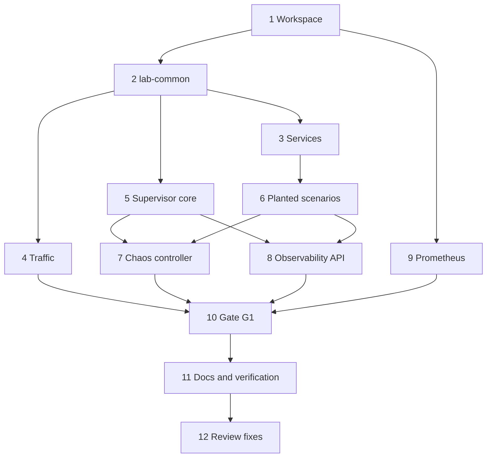

# Implementation Plan: haunted-lab

## Overview

Build the lab in 12 top-level tasks: workspace tooling, the shared package, four services, the traffic generator, the supervisor core, the planted scenarios, the chaos controller, the observability API, Prometheus, the Gate G1 check, and docs with final verification. Each task ships with its tests. Property tests are their own sub-tasks (marked `*`) and carry the comment `// Feature: haunted-lab, Property N`. Unit and property tests never need Docker or a public network. Library versions are pinned exactly: `prom-client` 15.1.3, `fast-check` 4.10.2, `vitest` 5.1.0, `@types/node` 26.6.6, TypeScript 7.0.2 with the same typescript-eslint aliasing used in Haunted Ops (checked against the registry on 2026-11-13). Do not copy code from `../haunted-ops`, `../seance` or `../seance-crew`.

## Tasks

- [x] 1. Workspace and tooling
  - [x] 1.1 Add `tsconfig.json` files for `packages/lab-common`, `services/*` and `supervisor` extending `tsconfig.base.json` with `allowImportingTsExtensions`, `noEmit`, `erasableSyntaxOnly`, `verbatimModuleSyntax` and `types: ["node"]`; add a root Vitest config
    - _Requirements: 1.1, 1.6_
  - [x] 1.2 Create package skeletons `packages/lab-common`, `services/gate`, `services/orders`, `services/payments`, `services/ledger` and `supervisor` with `typecheck`, `lint`, `test` and `build` scripts (`build` runs the typecheck) and exact-pinned dependencies
    - _Requirements: 1.1, 1.3, 1.4_
  - [x] 1.3 Prove on Node 26 that `node src/main.ts` runs from a git worktree whose `node_modules` entries are symlinks to the primary checkout, including loading `@haunted-lab/common` from `./src/index.ts`; record the outcome in Notes (fall back to a documented alternative if it fails)
    - _Requirements: 1.6_
  - [x] 1.4 Confirm the four root scripts exit 0 on the empty and on the populated workspace, and that `.gitignore` ignores the listed paths and not `.kiro/` (`git check-ignore`)
    - _Requirements: 1.2, 1.3, 1.5_
- [x] 2. Shared package `lab-common`
  - [x] 2.1 Implement `parseEnv` and `ConfigError` that report NAMES only
    - _Requirements: 2.7_
  - [x] 2.2 Implement `Ring<T>` with capacity, `push` and `latest(limit)`; create the Error_Ring (200) and Log_Ring (500)
    - _Requirements: 4.1, 4.2, 4.3, 4.4_
  - [x] 2.3* Property test: rings stay bounded and ordered (Property 1)
    - _Requirements: 4.1, 4.2, 4.3, 4.4_
  - [x] 2.4 Implement `createMetrics` (`http_requests_total`, `http_request_duration_seconds` with the required buckets) and route-template matching with the `unmatched` label; skip `/metrics`, `/healthz`, `/debug/*`
    - _Requirements: 3.1, 3.2, 3.3, 3.4, 3.5, 3.6_
  - [x] 2.5* Property test: route labels are bounded (Property 2)
    - _Requirements: 3.4, 3.6_
  - [x] 2.6 Implement `createServer` on `node:http`: routing, 404 and 405, `readJsonBody` with the 8 KiB limit, request ids via `sanitizeRequestId`, 500 conversion with an Error_Ring entry, `/healthz`, `/metrics`, `/debug/errors`, `/debug/logs` (GET only), stdout plus Log_Ring logging without bodies
    - _Requirements: 2.2, 2.5, 2.6, 2.8, 4.4, 4.5, 4.6, 4.7_
  - [x] 2.7* Property test: body limit is exact (Property 10)
    - _Requirements: 2.5, 7.9_
  - [x] 2.8* Property test: request ids are sanitised (Property 15)
    - _Requirements: 4.5_
  - [x] 2.9 Implement `bearerMatches` (SHA-256 of both sides, then `timingSafeEqual`) and the shared 401 response helper
    - _Requirements: 7.1, 8.1_
  - [x] 2.10* Property test: bearer comparison is exact (Property 3)
    - _Requirements: 7.1, 8.1, 8.2_
  - [x] 2.11 Implement `callJson` with a 3 s timeout, request id propagation and 502 mapping helper
    - _Requirements: 2.4, 4.5_
- [x] 3. Four services
  - [x] 3.1 Implement `ledger` (`POST /ledger/entries`, `LEDGER_PORT` read in `loadConfig()`, `SERVICE_BIND_HOST`)
    - _Requirements: 2.1, 2.2, 2.3, 2.7, 2.9_
  - [x] 3.2 Implement `payments` (`POST /payments/charge`, synthetic refund table, `findRefund` with its `undefined` guard, calls `ledger`)
    - _Requirements: 2.1, 2.3, 2.4, 2.9_
  - [x] 3.3 Implement `orders` (`POST /orders`, short simulated stock reservation, calls `payments`)
    - _Requirements: 2.1, 2.3, 2.4, 2.9_
  - [x] 3.4 Implement `gate` (`POST /checkout` with validation, calls `orders`)
    - _Requirements: 2.1, 2.3, 2.4, 2.6, 2.9_
  - [x] 3.5 Write a loopback chain test that starts the four services on random ports and checks success, 400, 413, 502 when `ledger` is stopped, `/healthz`, `/metrics` labels, `/debug/errors` and `/debug/logs` (405 for POST)
    - _Requirements: 2.3, 2.4, 2.5, 2.6, 2.8, 3.1, 3.2, 4.4, 4.6_
  - [x] 3.6 Add a baseline test that, under 5 rps for 10 s on `main`, the error ratio stays below 0.01 and p95 below 0.25 s on every service
    - _Requirements: 9.8_
- [x] 4. Traffic generator
  - [x] 4.1 Implement `nextInterval(rps, rand)` and `TrafficGenerator` (default 5 rps from `TRAFFIC_RPS`, 50 in-flight cap, skip instead of queue, swallow errors, synthetic payloads, `gate` only)
    - _Requirements: 5.1, 5.2, 5.3, 5.4, 5.5_
  - [x] 4.2* Property test: jitter stays within bounds (Property 12)
    - _Requirements: 5.2_
  - [x] 4.3* Property test: in-flight requests never exceed the cap (Property 16)
    - _Requirements: 5.3_
- [x] 5. Supervisor core
  - [x] 5.1 Implement `config.ts`: ports, `TRAFFIC_RPS`, `CHAOS_TOKEN` (at least 16 chars) and `LAB_READ_TOKEN` required; print NAMES only and exit 1; bind `127.0.0.1`
    - _Requirements: 7.2, 6.11_
  - [x] 5.2 Implement `refs.ts`: Allow_List and `classifyRef` (`allowed`, `reserved`, `denied`)
    - _Requirements: 6.1, 7.7, 7.8_
  - [x] 5.3* Property test: only allow-listed refs deploy (Property 4)
    - _Requirements: 6.1, 7.7, 7.8_
  - [x] 5.4 Implement `git.ts` (`execFile` argument arrays only) and `worktrees.ts` (`worktrees/<service>@<sha>`, `git worktree add --detach`, node_modules links)
    - _Requirements: 6.1, 6.2_
  - [x] 5.5 Implement `DeployLog` (`append`, `readAll`, `nextId` starting at 101, resume from the file, append-only)
    - _Requirements: 6.6, 6.7, 6.8_
  - [x] 5.6* Property test: deploy ids are unique, increasing and survive restart (Property 5)
    - _Requirements: 6.6, 6.7, 6.8_
  - [x] 5.7 Implement `nextDelay` and `ServiceRunner`: fixed child env list, stdout and stderr capture into a 500-line buffer, restart with backoff, 60 s stable reset, stop with SIGTERM then SIGKILL after 5 s, SIGTERM and SIGINT handling in the Supervisor
    - _Requirements: 6.3, 6.4, 6.5, 6.10, 6.11_
  - [x] 5.8* Property test: backoff is monotone, capped and resettable (Property 6)
    - _Requirements: 6.4, 6.5_
  - [x] 5.9* Property test: env values never leave the process (Property 13)
    - _Requirements: 2.7, 4.7, 6.3, 8.10_
- [x] 6. Planted scenarios
  - [x] 6.1 Implement `scripts/plant-scenarios.mjs`: fixed identity and dates through `GIT_AUTHOR_*` and `GIT_COMMITTER_*` env, branches created from the current `main` tip with `execFile`, idempotent (existing branch with the expected tree is left alone), writes `scripts/scenario-shas.json` with `{ base, shas }`
    - _Requirements: 9.1, 9.2, 9.3_
  - [x] 6.2 Write the three culprit patches: `payments` "simplify refund lookup" (remove the guard), `orders` "add inventory freshness check" (8 sequential calls of about 200 ms), `ledger` "tidy config loading" (read `LEDGER_LISTEN_PORT`); each touches only its own service
    - _Requirements: 9.4, 9.5, 9.6_
  - [x] 6.3 Add the fixture-repo test with hard-coded SHAs and the real-repo test that compares to `scenario-shas.json` and fails with a clear message when `main` moved
    - _Requirements: 9.2, 9.7_
  - [x] 6.4* Property test: planting is deterministic and idempotent (Property 11)
    - _Requirements: 9.1, 9.2, 9.3, 9.7_
  - [x] 6.5 Add a behaviour test that runs each scenario branch from a temp worktree: about 30 percent 500s on `payments`, p95 over 1.5 s with no errors on `orders`, exit code 1 with `missing required env: LEDGER_LISTEN_PORT` on `ledger`
    - _Requirements: 9.4, 9.5, 9.6_
  - [x] 6.6 Run the Plant_Script on this repo, commit nothing, and record the three SHAs and the `main` base in Notes
    - _Requirements: 9.1, 9.7_
- [x] 7. Chaos controller
  - [x] 7.1 Implement `server.ts`: single `node:http` server on `127.0.0.1`, auth per prefix, 8 KiB body limit, 404 and 405, one mutex for apply and reset
    - _Requirements: 7.1, 7.9, 7.10, 7.11_
  - [x] 7.2 Implement `scenarios.ts` and `chaos.ts`: boot deploy of `main` for all services, `apply`, `reset`, `state`; only services whose ref or sha changed restart and get a Deploy_Record; actor `chaos` or `supervisor`
    - _Requirements: 6.6, 6.9, 7.3, 7.4, 7.5, 7.6_
  - [x] 7.3 Refuse Reserved_Refs with 403 `ref_reserved` and a clear message, and never use a ref or path from the request body
    - _Requirements: 7.7, 7.8, 7.9_
  - [x] 7.4* Property test: apply and reset converge (Property 14)
    - _Requirements: 6.6, 7.3, 7.5_
  - [x] 7.5 Write an integration test that starts the real Supervisor on random ports against a temp clone with planted branches (`TRAFFIC_RPS=0`): apply each scenario, check state, crash-loop status for `dark-room`, reset, 401, 404, 403, 405, 413
    - _Requirements: 6.1, 6.4, 6.9, 7.1, 7.3, 7.4, 7.5, 7.6, 7.8, 7.9, 7.11_
- [x] 8. Observability API
  - [x] 8.1 Implement the query parser for `service`, `since` and `limit`
    - _Requirements: 8.9_
  - [x] 8.2* Property test: query parameters are validated totally (Property 7)
    - _Requirements: 8.9_
  - [x] 8.3 Implement `GET /lab/errors`, `/lab/logs` and `/lab/deploys` (service errors fetched from `/debug/errors`, supervisor exit events, captured output buffer, JSON content type, GET only)
    - _Requirements: 8.3, 8.4, 8.5, 8.10, 8.11_
  - [x] 8.4 Implement `GET /lab/commits/{sha}/diff` using `git merge-base --is-ancestor` against each Allow_List Ref and `git show` through `execFile`
    - _Requirements: 8.6, 8.7_
  - [x] 8.5* Property test: diffs are served only for reachable commits (Property 9)
    - _Requirements: 8.6, 8.7_
  - [x] 8.6 Implement the size capper (64 KiB diff, 256 KiB lists, `truncated` flag)
    - _Requirements: 8.8_
  - [x] 8.7* Property test: response size caps hold (Property 8)
    - _Requirements: 8.8_
  - [x] 8.8 Extend the integration test: both tokens against both prefixes, error and log content after `error-spike` and `dark-room`, diff of each culprit SHA, unreachable SHA, bad parameters, non-GET methods
    - _Requirements: 8.1, 8.2, 8.3, 8.4, 8.5, 8.6, 8.7, 8.9, 8.10_
- [x] 9. Prometheus and compose
  - [x] 9.1 Write `deploy/prometheus.yml` (5 s scrape interval and evaluation, `service` label per target, targets read from a file)
    - _Requirements: 10.1, 10.4_
  - [x] 9.2 Write `deploy/compose.yaml` publishing Prometheus on `127.0.0.1:9090` only, with a Mac target file and an EC2 (host network) target file
    - _Requirements: 10.2, 10.3, 10.4_
  - [x] 9.3 Verify with `docker compose` on this Mac (colima) that all four targets turn up with the Supervisor running; record the bind-host setting needed in Notes; mark `podman compose` as not verified here
    - _Requirements: 10.1, 10.2_
- [x] 10. Gate G1 check
  - [x] 10.1 Implement `scripts/g1-check.mjs` start-up: spawn the Supervisor, start Prometheus with the compose command found on the machine, wait for four targets up, always clean up
    - _Requirements: 11.1, 11.5_
  - [x] 10.2 Implement scenario assertions with PromQL over `[20s]` windows: error ratio above 0.2 on `payments`, `histogram_quantile(0.95, ...)` above 1 on `orders`, `up{service="ledger"} == 0`; poll up to 30 s; reset and assert recovery within 30 s
    - _Requirements: 11.2, 11.3_
  - [x] 10.3 Print the table (scenario, signal, observed value, seconds to detect, seconds to recover) and exit 0 or 1
    - _Requirements: 11.4, 11.5_
  - [x] 10.4 Run the check on this Mac and record the table in Notes
    - _Requirements: 9.8, 11.2, 11.3_
- [x] 11. Docs and final verification
  - [x] 11.1 Write `docs/DEV.md`: setup, env names, run the Supervisor and Prometheus, plant scenarios, run G1, Mac versus EC2 notes
    - _Requirements: 12.1_
  - [x] 11.2 Finish `.env.example` and scan all files for secrets, absolute home paths and forbidden retro-client words
    - _Requirements: 12.2, 12.4_
  - [x] 11.3 Append one line per finished task to `docs/KIRO_USAGE.md`
    - _Requirements: 12.3_
  - [x] 11.4 Run `pnpm install && pnpm typecheck && pnpm lint && pnpm test && pnpm build` and confirm each exits 0
    - _Requirements: 1.2, 1.3_
- [x] 12. Review fixes (code review and security review, before the first commit)
  - [x] 12.1 Plant check for this repo: `verifyPlantRecord` (each scenario branch one commit on `record.base`, base an ancestor of `main`, SHAs equal the record) instead of `main === base`; test that a later commit on `main` still passes and a stale or rewritten record fails
    - _Requirements: 9.7, 9.9_
  - [x] 12.2 Planted dates = base committer date + 1 h / 2 h / 3 h; snapshot repo keeps its fixed date; update the exact snapshot SHAs; test the dates against a late base
    - _Requirements: 9.1, 9.2, 9.3_
  - [x] 12.3 Refuse `change-me*` placeholder tokens and `CHAOS_TOKEN === LAB_READ_TOKEN` at start, names only in the error; tests
    - _Requirements: 7.2_
  - [x] 12.4 Children in their own process group (`detached`, group signals, `--lab-service=<name>` marker), `data/pids.json`, stale-pid cleanup before deploy with a command-line check; unit tests and a real supervisor SIGKILL in the integration test
    - _Requirements: 6.10, 6.12, 6.13_
  - [x] 12.5 Remove stale worktrees at start and the previous one after each Deploy (`git worktree remove --force` + `prune`), only inside the worktrees dir; document why the live checkout is the default repo; tests
    - _Requirements: 6.1, 6.14_
  - [x] 12.6 git without user/system config and with a timeout on every call, including `commitDiff`; diffs limited to `-- services packages`; remove the dead hex check; tests
    - _Requirements: 6.2, 6.15, 8.6, 8.14_
  - [x] 12.7 Bound before cleaning; strip every absolute path (repo, `node_modules`, other) from frames, messages and log lines; tests
    - _Requirements: 8.13_
  - [x] 12.8 `DeployLog` reads the file once and serves a bounded in-memory tail; test that reads never touch the file
    - _Requirements: 6.8, 8.5, 8.15_
  - [x] 12.9 `"untrusted": true` on every `/lab/*` body (errors too), ANSI and control characters removed and per-field caps on `message`, `line`, `frame`, `diff`, `subject`, `author`, `ref`; document the untrusted-input rule in design.md; tests
    - _Requirements: 8.11, 8.12_
  - [x]* 12.10 Property test: untrusted text is bounded, control-free and path-free (Property 17)
    - _Requirements: 8.12, 8.13_
  - [x] 12.11 Initialise `http_requests_total` at 0 for codes 200 and 500 per route; note `or vector(0)` and `avg_over_time(up[w])` for consumers; test
    - _Requirements: 3.7_
  - [x] 12.12 Linux compose override (`network_mode: host`, Prometheus on 127.0.0.1, services stay on 127.0.0.1), G1 uses it on Linux; DEV.md for Mac and Linux; security.md notes for `/debug/*` and future `exorcist/*` children; config test
    - _Requirements: 10.2, 10.3, 10.5_
  - [x] 12.13 Tests without `Math.random` or tight wall-clock bounds (seeded RNG, fake clock); route tests for payments, orders and ledger; one in-process test per scenario patch
    - _Requirements: 2.3, 2.4, 2.6, 9.4, 9.5, 9.6_
  - [x] 12.14 `.gitignore` adds `.DS_Store`, `*.pem`, `coverage/` (and the test-only `services/*/.scenario-*/`); full check chain and G1 re-run
    - _Requirements: 1.2, 1.3, 1.5, 11.2, 11.3_

## Task Dependency Graph



```json
{
  "waves": [
    { "id": 0, "tasks": ["1"] },
    { "id": 1, "tasks": ["2", "9"] },
    { "id": 2, "tasks": ["3", "4", "5"] },
    { "id": 3, "tasks": ["6"] },
    { "id": 4, "tasks": ["7", "8"] },
    { "id": 5, "tasks": ["10"] },
    { "id": 6, "tasks": ["11"] },
    { "id": 7, "tasks": ["12"] }
  ]
}
```

## Notes

- Sub-tasks marked `*` are property-based tests. They are required: every correctness property has one.
- Planted SHAs depend on the `main` tip. Any commit to `main` after planting means re-running the Plant_Script and updating `scripts/scenario-shas.json` (the save hook reminds you).
- Task 1.3 is a risk check. If symlinked `node_modules` do not work with Node type stripping, fall back to running `pnpm install --offline --frozen-lockfile` inside each worktree and record the cost here.
- On the Mac, containers cannot reach host loopback. Task 9.3 records the `SERVICE_BIND_HOST` value that works with colima. The Supervisor and Prometheus stay on `127.0.0.1` in every case.
- `exorcist/*` fix-branch deploys are reserved: recognised, refused with 403 `ref_reserved`. Enabling them is a later spec.
- Out of scope: the Exorcist agent and its MCP tools, the Haunted Ops api and scene, pull request creation, public hosting.
- Task 1.3 outcome: confirmed on Node 26.7.0. A service runs as `node src/main.ts` from `worktrees/<service>@<sha>/services/<service>` with only `services/<service>/node_modules` symlinked to the primary checkout; `@haunted-lab/common` and `prom-client` resolve through the symlink to the primary checkout, so type stripping applies (no file under `node_modules`). No fallback needed.
- Task 3 outcome: Node's `fetch` (undici) adds about 300 ms on this Mac when it reuses an idle keep-alive socket (a bare `node:http` server showed it too; `http.request` and `connection: close` did not). `callJson`, the traffic generator and the baseline test use `httpRequest` (`node:http`, keep-alive agent) instead. Baseline on `main` then stays well under p95 0.25 s.
- Task 6.6 outcome: this repo's `main` (`0dba27a`, the scaffold commit) holds no service code, and this prompt allows no commit, so planting here is blocked: `plant-scenarios.mjs` stops with "main has no services/payments/src/refunds.ts; commit the services before planting". It was run instead on the deterministic snapshot repo (`scripts/build-lab-repo.mjs`), identical on every run and machine: base `019b0a8750f998ed4e829f1023df0e17be1e0f5b`, `scenario/error-spike` `b32b761302380a72b9a97c24c89e8b75550205c8`, `scenario/fog` `87908f4e7f36d6607e887b6ba448c06f55b42aac`, `scenario/dark-room` `9ba8c15133b59bfbcc6aa8e4cd955227aea11f10` (asserted in `supervisor/test/plant.test.ts`). After the services are committed: run `node scripts/plant-scenarios.mjs` here; it writes `scripts/scenario-shas.json` and the real-repo test (skipped until then) starts guarding it. Those SHAs will differ from the snapshot ones because `main` differs.
- Task 9.3 outcome: on colima, a container reaches the Mac's `127.0.0.1` through `host-gateway` (checked with a probe container), so `SERVICE_BIND_HOST` stays `127.0.0.1`. The `docker compose` CLI plugin is not installed on this Mac; the standalone `docker-compose` 5.6.0 works and G1 falls back to it. `podman compose` on EC2 is not verified here.
- Task 10.4 outcome (this Mac, snapshot repo, 5 rps, `[15s]` windows):

| scenario    | signal             | threshold | observed | detect_s | recovered | recover_s | result |
|-------------|--------------------|-----------|----------|----------|-----------|-----------|--------|
| error-spike | payments 5xx ratio | > 0.2     | 0.283    | 15.2     | 0         | 10.9      | PASS   |
| fog         | orders p95 (s)     | > 1       | 2.157    | 6.0      | 0.049     | 3.0       | PASS   |
| dark-room   | ledger up          | == 0      | 0        | 4.9      | 1         | 6.0       | PASS   |

- `prom-client` 15.1.3 is the latest release, but the registry marks it deprecated in favour of `@prometheus-io/client`. It is kept because the spec names it; switching is a separate decision.
- Error frames, exit messages and log lines served by `/lab` have absolute worktree paths rewritten to repo paths, so no local path leaves the supervisor.
- Task 12 outcome: review fixes done. The snapshot SHAs moved (lab-common source changed and planted dates are now base + 1/2/3 h) and are asserted exactly: base `377121f304ff4fd51f1a7edc7ac6b99651e97f12`, `scenario/error-spike` `2b89664deaf7e2e393ff71de3c6c40c2bc2de5f4`, `scenario/fog` `83e12fd39c6e4c4ad1eaa6506a769cd55ed1bb16`, `scenario/dark-room` `182227f4f99444ab2fc306be4cde07a4c21157b9` (identical across two independent builds). They supersede the task 6.6 values. G1 re-run on this Mac (snapshot repo):

| scenario    | signal             | threshold | observed | detect_s | recovered | recover_s | result |
|-------------|--------------------|-----------|----------|----------|-----------|-----------|--------|
| error-spike | payments 5xx ratio | > 0.2     | 0.204    | 14.9     | 0         | 6.9       | PASS   |
| fog         | orders p95 (s)     | > 1       | 2.425    | 7.0      | 0.046     | 14.6      | PASS   |
| dark-room   | ledger up          | == 0      | 0        | 3.0      | 1         | 5.0       | PASS   |

  G1 reports the first sample past the threshold, so "observed" sits near the threshold while the rate window fills.
- `deploy/compose.linux.yaml` uses the compose `!reset` / `!override` tags (Compose spec 2.24+, podman-compose 1.1+). Its merged config was checked with `docker-compose config` here; it has not run on EC2.
